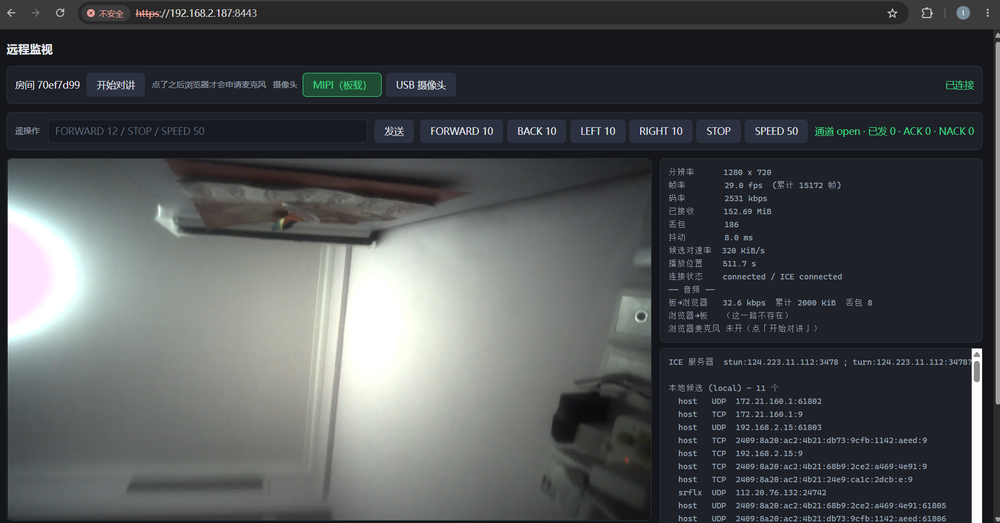
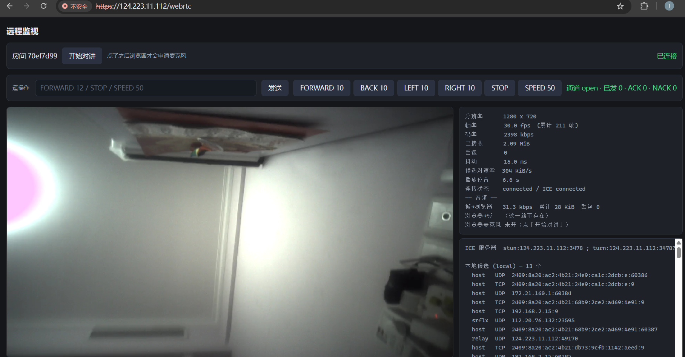

# WebRTC Remote Monitor

Live camera view, two-way voice, and data-channel teleoperation for an Orange Pi 5
(RK3588) — straight into a browser, with no plugins and no vendor SDK.

The publisher **dials out**; it opens zero inbound TCP ports. Media is standard WebRTC
(DTLS/SRTP + ICE), so it works on a LAN and across the public internet through a
coturn relay fallback.


---

## Demo

Demo video: [WebRTC remote monitor (Bilibili)](https://www.bilibili.com/video/BV1Qenn6AEtQ/)

Both screenshots below are live sessions through the two supported entry points
(rendered at equal width):

<p align="center">
  
  
</p>

| LAN: browser talks to the board | WAN: browser goes through the VPS |
|:---:|:---:|
| `https://<board-ip>:8443/`. Page, signaling and media stay on the LAN; the board serves the page and proxies signaling | `https://<vps>/webrtc`. nginx terminates TLS and enforces Basic Auth; media uses coturn relay when it cannot go direct |

Both entries point at the **same room and the same publisher**. One viewer is a design
constraint, so they cannot watch simultaneously: the second connection is rejected with
an explicit "device busy" status instead of kicking the first viewer off.

---

## What it does

- **720p live video** — MIPI camera (OV13850) or USB camera, hardware H.264 encode on
  the RK3588, Opus audio, all negotiated as one WebRTC session.
- **Hot camera switching** — swap the capture chain at runtime from the page. No new
  offer, no reconnect, no audio interruption; the worst video stall is one GOP
  (measured **367 ms** at `gop=10`).
- **Two-way voice** — board microphone → browser, and browser microphone → board's
  3.5 mm output. Independent up/down counters, because "video works" says nothing
  about audio.
- **Teleoperation over a DataChannel** — whitelisted commands, per-command ACK/NACK,
  and the command is rendered into the video stream itself (`CMD #7 FORWARD 10 ...`
  in the top-left corner). The text can only come from the board, so it proves both
  the control path and the media path in one glance.
- **LAN and public deployment from the same code** — a single `signal_server.py` runs
  on the board for LAN-only mode or on a VPS with coturn for WAN access.
- **Optional ROS 2 mode** — `--mode ros` publishes the image over the ROS topic bus:
  capture and inference are ordinary ROS nodes, detection results are available to any
  subscriber, and WebRTC only pushes the annotated topic to the browser. See
  [ROS 2 mode](#ros-2-mode-the-picture-rides-the-topic-bus).

## Architecture

```
        ┌───────────────────── Public VPS (optional) ─────────────────────┐
        │  nginx :443 ──┬── /ws/publish ───────────────→ 127.0.0.1:8443   │
        │               ├── /ws/view /ice.json /diag ──→ 127.0.0.1:8443   │
        │               └── /webrtc /config.json /camera → 127.0.0.1:8444 │
        │  signal_server.py :8443          web_server.py :8444            │
        │  coturn :3478 (STUN/TURN fallback)                              │
        └───────────────▲──────────────────────────▲─────────────────────┘
                        │ wss (publish)            │ wss (view)
        ┌───────────────┴──────────────────────────┴─────────────────────┐
        │ board                                                          │
        │   device_agent.py  ← outbound only, zero inbound TCP ports     │
        │   web_server.py :8443 (LAN page + same-origin proxy)           │
        │   GStreamer: v4l2src → mpph264enc → rtph264pay → webrtcbin     │
        │              alsasrc → opusenc → rtpopuspay ────↗              │
        │              webrtcbin → opusdec → alsasink (return audio)     │
        └───────────────▲────────────────────────────────────────────────┘
                        │ DTLS/SRTP — direct, or TURN relay when needed
                   browser (LAN or WAN)
```

**Signaling is separate from media.** The signaling server only matches a publisher
and a viewer (and hands out TURN credentials); RTP never goes through it unless ICE
chooses the relay. In the LAN entry, the board's `web_server` relays the browser's
signaling to the VPS, so the browser only has to trust the board's self-signed
certificate.

Only **one viewer** is accepted at a time — this is designed as a teleoperation
console, not a broadcast service, so there is one session, one pipeline, and no
multi-viewer fan-out.

## Engineering highlights

### 1. Camera switching without renegotiation

The pipeline is split into an immutable **skeleton** and a replaceable **capture
segment**. The split point is after `h264parse`:

```
skeleton (built once)                       segment (replaced on every switch)
webrtcbin ← vq ← rtph264pay ←ghost─ v4l2src ! [mppjpegdec] ! mpph264enc ! h264parse
  ↑ audio aq ← rtpopuspay
```

Because `rtph264pay` stays in the skeleton, its RTP timestamp base and SSRC survive
the switch — the browser never sees a new stream. Both cameras are deliberately forced
to the same encoded caps, so no renegotiation is needed at all.

### 2. Image quality when the board has no 3A

Orange Pi 5 ships **no `rkaiq_3A_server`**, and Rockchip's AE/AWB live in that
userspace service. The result is one root cause with three symptoms: black (gain at the
driver default), green (no AWB), and blown out (gain pushed too hard).

- `camera.py` measures luminance on the ISP self-path and closes a loop on the sensor's
  `analogue_gain` / `exposure` subdev controls.
- `whitebalance.py` does a gray-world correction with a small
  `appsink → numpy → appsrc` bridge, calibrating on the first 15 frames and then
  freezing the gains. It rejects dark or clipped calibration frames instead of
  producing a confident wrong answer.
- The USB camera has its own AE/AWB, so the fallback is explicitly skipped for it.

### 3. A verification harness, not a vibe check

Each stage has a falsifiable acceptance criterion. The point is to catch the failures
that *look* like success:

| Criterion | The lie it prevents |
|---|---|
| Nominated candidate pair's byte counter keeps growing | `iceConnectionState=connected` with zero media |
| `framesDecoded` grows, not just `bytesReceived` | "RTP arrived" reported as "a frame decoded" |
| Sent vs received bytes ≈ 1.0 | One-way media mistaken for two-way |
| Steady-state sampling window | The startup ramp producing a fake 5 fps |
| `selectedCandidatePair` re-read every sample | A frozen pair from before an ICE restart |
| `sent == acked + nacked` | A dropped command mistaken for "the page never sent it" |
| Board-side `teleop_overlay` tracks ACKs | A truthful ACK over a dead video path |
| Board-side `teleop_rx` matches page-side `sent` | The page grading its own homework |

## ROS 2 mode: the picture rides the topic bus

`--mode ros` wires the same WebRTC stack to ROS 2 topics: capture and inference each
become an ordinary ROS node, and the publisher degrades into "subscribe to the
annotated image, encode, send". The point is to keep detection results usable by other
nodes (planning, control) instead of trapping them inside the streaming process.

```
camera_node ──/camera/image_raw──> detector_node ──/detect/image_annotated──┐
    │                                  │                                     │
    │ /camera/source (latched)         │ /detect/persons (JSON)              │
    └── /camera/select                 └─────────────────────────────────────┘
                                                                             ▼
                                                    device_agent --mode ros
                                                    RosLink  : switches, reports, stats
                                                    RosBridge: annotated image → appsrc
                                                      → videoconvert → mpph264enc
                                                      → rtph264pay → webrtcbin
```

Three processes, topics as the only coupling:

| Topic | Type | Direction | Contents |
|---|---|---|---|
| `/camera/image_raw` | `sensor_msgs/Image` (`bgr8`) | camera_node → detector_node | raw 720p frame |
| `/detect/image_annotated` | `sensor_msgs/Image` (`bgr8`) | detector_node → agent | boxes already drawn in |
| `/detect/persons` | `std_msgs/String` (JSON) | detector_node → anyone | boxes, scores, inference time |
| `/camera/select` | `std_msgs/String` | agent → camera_node | ask for a different camera |
| `/camera/source` | `std_msgs/String` (latched) | camera_node → agent | which camera is **actually** open |

Detection results are JSON in a `std_msgs/String` rather than a custom message: the
board has no internet access, a rosidl custom type needs its own colcon package, and a
planning node only needs `json.loads`.

```json
{"count": 1, "inference_ms": 23.4,
 "stamp": {"sec": 1793021234, "nanosec": 512000000},
 "frame": {"height": 720, "width": 1280},
 "boxes": [{"label": "person", "score": 0.87, "x1": 512, "y1": 96, "x2": 704, "y2": 611}]}
```

### Running it

```bash
tools/build-ros-ws.sh            # colcon build --symlink-install
MODE=ros tools/service.sh restart   # nodes + web + agent in one go
```

Put `MODE=ros` in `.env` and the prefix goes away: `tools/service.sh restart`,
`stop` and `status` then manage all three. What `all` means depends on the mode:

| mode | `service.sh start/stop/restart all` |
|---|---|
| `monitor` (default) | `web` + `agent` |
| `ros` | `nodes` (camera_node + detector_node) + `web` + `agent` |

Target the nodes alone (extra arguments are passed through to `ros2 launch`):

```bash
tools/service.sh restart nodes
tools/service.sh restart nodes camera_source:=usb width:=640 height:=480
tools/service.sh logs nodes -f
```

Order does not matter: with no nodes running the agent simply has no picture yet. To
run at another resolution, pass it to both sides:

```bash
tools/service.sh restart nodes width:=640 height:=480   # and --width/--height on the agent
```

**The resolution is a contract between the two processes.** `appsrc` caps are fixed, so
a size mismatch drops every frame — `ros2 topic hz` shows 30 Hz while the browser stays
black and `/stats`'s `ros_errors` climbs. That is the first criterion in
`tools/check_ros_mode.sh`.

### Why three processes

- **A broken detector does not take the preview down.** If the model or the NPU is
  unavailable, `detector_node` still forwards the raw frame as the annotated topic — just
  without boxes — so debugging does not chase the wrong layer.
- **Restarting a node does not restart the session.** Signaling, ICE and audio live in
  the agent; restarting `camera_node` freezes the picture for a few seconds, nothing more.
- **Subscriptions are created per viewer.** With nobody watching, no 720p frame is
  copied at all; camera switching and detection stats keep working without a session.

### Switching cameras is not local in this mode either

The camera belongs to `camera_node`. The page asks the agent, the agent publishes
`/camera/select`, and `camera_node` reports `/camera/source` only after it has reopened
the device, run the brightness loop and **produced a first frame** (8 s budget).
`applied` in the HTTP reply means "that report arrived" — publishing a message always
succeeds, only the device side counts.

### Differences from monitor mode

| | monitor (default) | ros |
|---|---|---|
| Capture / inference | in-process | `camera_node` / `detector_node` |
| Boxes | `textoverlay` burned into H.264 | drawn by `detector_node` with OpenCV |
| Teleop console | yes (DataChannel + on-screen text) | **no** (a shared bus picture should not be annotated by one consumer) |
| Camera switch | replace the capture segment | publish a request, device reopens |
| Signaling / ICE / audio return / sessions | identical code | identical code |

### Verification

```bash
python3 tools/check_ros_mode.py                    # host: 35 checks, no ROS/GStreamer/NPU
bash tools/check_ros_mode.sh --switch-to usb       # board: reads the agent's /stats
```

Board-side criteria are device-side facts: `ros_frames` (topic → appsrc),
`video_packets_out` (RTP actually sent), `ros_errors` (must be 0), `ros_source` (what
`camera_node` reported). Either one alone can lie — frames climbing with RTP flat means
the encoder/webrtcbin is stuck, RTP climbing with frames flat means the picture froze
long ago.

### Caveats

- **Bandwidth**: 1280×720 `bgr8` is ~**55 MB/s**. Fine over loopback; over a real network
  subscribe to `/detect/persons` instead of the image.
- **USB (MJPG) decodes in software by default.** On this board `mppjpegdec` takes about
  1.5 s per 720p MJPG frame and reports no error at all (`v4l2src` alone does 16 fps and
  `jpegdec` also does 16 fps). So `camera_node` defaults to `camera_decoder=sw`, roughly
  one core; on a board where MPP behaves,
  `tools/run-ros-nodes.sh camera_decoder:=mpp` buys that core back. MIPI (raw) is
  unaffected.
- **The model is not in the repo** (`.rknn` is gitignored). Point at it with `model:=...`.
- **ROS mode needs `/opt/ros/humble/setup.bash` and the user-site numpy out of the way**:
  the board's system numpy is 1.21 (what `python3-opencv` was built against) and a
  user-site numpy 2.x breaks `import cv2` with an ABI error. The agent runs under
  `python3 -s`; the nodes get `PYTHONNOUSERSITE=1` (a `ros2 launch` child cannot take
  `-s`). `tools/run-agent.sh` and `tools/run-ros-nodes.sh` handle both.
- **One viewer** stays a design constraint, in both modes.

## Measured results

| Metric | Value | Notes |
|---|---|---|
| Video | 1280×720 H.264, 2500 kbps | MIPI `UYVY` path is ISP-throughput bound at **~20.4 fps** |
| Camera switch stall | **367 ms** | `gop=10`; upper bound is one IDR interval |
| MIPI low light | gain 16 → **Y≈9.7**; gain 248 + exposure 1648 → **Y≈78** | No AE; closed loop hits the sensor ceiling |
| USB camera | **Y≈226** | Built-in AE/AWB, fallback skipped |
| Missing AWB | **G/R=1.71, G/B=1.55** | Gray-world correction, ~0.4 core at 720p, frame rate unchanged |
| Microphone probe | USB mic **12.9 %** FS vs floating 3.5 mm **0.25 %** | Catches a TRS (no-mic) headset before it silently streams noise |
| Verification suite | **13 / 17 / 22 criteria** | video / + audio / + teleop |

## Quick start

### Prerequisites

Debian/Ubuntu on arm64, with the board's MPP GStreamer plugins installed
(`mpph264enc`, `mppjpegdec` — vendor packages, not in Debian):

```bash
sudo apt install python3-gi python3-aiohttp python3-numpy \
    gir1.2-glib-2.0 gir1.2-gstreamer-1.0 \
    gir1.2-gst-plugins-base-1.0 gir1.2-gst-plugins-bad-1.0 \
    v4l-utils alsa-utils gstreamer1.0-tools
```

`numpy` is only needed for `--camera-wb`; see [requirements.txt](requirements.txt).

ROS 2 mode (`--mode ros`) additionally needs these (apt / vendor image, not pip):

```bash
sudo apt install ros-humble-ros-base python3-colcon-common-extensions \
    python3-opencv python3-numpy
# rknn-toolkit-lite2 ships with the board vendor image; the .rknn model is not in the repo
```

ROS mode has to source `/opt/ros/humble/setup.bash` and run under `python3 -s`;
`tools/run-agent.sh` and `tools/run-ros-nodes.sh` take care of both.

### LAN only (no VPS)

```bash
bash tools/gen_cert.sh          # self-signed cert; needed for the browser microphone

# terminal 1 — signaling (+ ICE config)
python3 src/signal_server.py --room demo --token hunter2 --ice-mode none --port 8080

# terminal 2 — publisher
python3 src/device_agent.py --signal ws://127.0.0.1:8080/ws/publish \
    --room demo --token hunter2
    # add --no-audio if there is no microphone

# terminal 3 — page + same-origin proxy (camera switching lives here)
python3 src/web_server.py --port 8443 --room demo --signal http://127.0.0.1:8080 \
    --tls-cert certs/board.crt --tls-key certs/board.key
```

Open `https://<board-ip>:8443/`. The page asks `/config.json` for the room number, so
`?room=` is optional. Accept the self-signed certificate once; that also unlocks
`getUserMedia` for two-way voice.

### Public deployment (current shape)

Three stages: **VPS** (signaling + coturn + viewer page + nginx), **board** (publisher +
LAN page), and **verification** from any machine that can reach either. The repo lives
on the dev machine and the board; the VPS copy is pushed by the deploy scripts, so no
`git clone` is needed there.

| Run on | What it does | Command |
|---|---|---|
| VPS | signaling server + coturn | `sudo bash tools/deploy_vps.sh` |
| dev machine | viewer page + nginx routes | `VPS_HOST=ubuntu@<vps> bash tools/deploy_web_vps.sh` |
| board | publisher + LAN page | `tools/service.sh start` |

#### 0. Prerequisites

**VPS**

- Ubuntu, reachable over ssh, with **passwordless `sudo`** for the deploy account
  (`deploy_web_vps.sh` runs `ssh ... 'sudo ...'` without a tty, so it cannot prompt).
- Security group **and** host firewall open: `TCP 443`, `UDP 3478`, `TCP 3478`,
  `UDP 49160-49200` (TURN relay range, matching `turnserver.conf`).
- `/etc/nginx/sites-available/default` must contain a **443 default server**;
  `deploy_web_vps.sh` only adds `location` blocks, it does not create the server:

  ```nginx
  server {
      listen 443 ssl http2 default_server;
      server_name _;
      ssl_certificate     /etc/nginx/ssl/self.crt;
      ssl_certificate_key /etc/nginx/ssl/self.key;
      location / { return 404; }
  }
  ```

  Sign the certificate once (the private key never leaves the VPS):

  ```bash
  sudo mkdir -p /etc/nginx/ssl
  sudo openssl req -x509 -newkey rsa:2048 -nodes -days 3650 \
      -keyout /etc/nginx/ssl/self.key -out /etc/nginx/ssl/self.crt \
      -subj "/CN=<VPS_IP>" \
      -addext "subjectAltName=IP:<VPS_IP>" \
      -addext "basicConstraints=critical,CA:TRUE"
  sudo chmod 600 /etc/nginx/ssl/self.key
  ```

  Copy `self.crt` back to the dev machine as `certs/vps-self.crt`; the board and the
  verification tools use it as their trust anchor.

**Board**

- Debian/Ubuntu arm64 with the vendor MPP GStreamer plugins (see Prerequisites).
- ssh access; the publish directory is fixed at `~/webrtc-remote-monitor`.
- `rsync` available for syncing the source tree.

**Dev machine**

- This repo, plus `ssh` / `rsync` to both the VPS and the board.

#### 1. VPS: signaling + coturn

`deploy_vps.sh` runs **on the VPS** and needs the repo's `src/`:

```bash
rsync -az --exclude .git --exclude .env --exclude certs --exclude run \
    ./ ubuntu@<vps>:~/webrtc-remote-monitor/
ssh -t ubuntu@<vps> 'cd ~/webrtc-remote-monitor && sudo bash tools/deploy_vps.sh'
```

It installs coturn + aiohttp, probes the public/private IPs, writes
`/etc/turnserver.conf` and `/etc/webrtc-signal.env` (room, publisher token, TURN
secret), installs `webrtc-signal.service` (loopback-only `127.0.0.1:8443`), and
self-checks. Keep the **room** and **token** it prints for the board's `.env`.

#### 2. VPS: viewer page + nginx

From the **dev machine**:

```bash
VPS_HOST=ubuntu@<vps> bash tools/deploy_web_vps.sh
```

It pushes `signal_server.py`, `web_server.py` and `monitor.html` to
`/opt/webrtc-signal/` and `/opt/webrtc-web-server/`, installs `webrtc-web.service`
(`127.0.0.1:8444`), installs the nginx snippet, adds HTTP Basic Auth to every viewing
route, and prints the external URL and credentials. `/ws/publish` is deliberately
left outside Basic Auth — it authenticates with the publisher token.

Put `VPS_HOST` in `.env` if you want `tools/service_vps.sh` to work without the
prefix.

#### 3. Board: code + certificates + `.env`

```bash
# 1) sync source; leaves the board's .env / certs / run untouched
rsync -az --exclude .git --exclude .env --exclude certs --exclude run \
    ./ orangepi@<board>:~/webrtc-remote-monitor/

# 2) the board's own self-signed cert (IP SAN; required for the browser microphone)
ssh orangepi@<board> 'cd ~/webrtc-remote-monitor && bash tools/gen_cert.sh'

# 3) public half of the VPS certificate, used as the trust anchor
scp certs/vps-self.crt orangepi@<board>:~/webrtc-remote-monitor/certs/

# 4) fill in .env
ssh orangepi@<board> 'cd ~/webrtc-remote-monitor && cp .env.example .env && $EDITOR .env'
```

| Variable | Purpose | Where it comes from |
|---|---|---|
| `ROOM` | the only room the signaling server accepts | `/etc/webrtc-signal.env` or the deploy output |
| `TOKEN` | publisher token for `/ws/publish` | same |
| `SIGNAL_HOST` | VPS public IP / hostname | your VPS |
| `SIGNAL_AUTH` | `user:pass` for `/ice.json`, `/diag`, `/ws/view` | printed by `deploy_web_vps.sh` |

#### 4. Start / stop (board)

```bash
tools/service.sh start          # everything the current mode needs; returns when usable
tools/service.sh status         # mode, processes, health check, last log line
tools/service.sh logs agent -f
tools/service.sh restart
tools/service.sh stop
```

Processes run in their own session (ssh disconnect does not kill them); pids live in
`run/*.pid` and logs in `run/*.log` (both gitignored). Target one service with
`web` / `agent`; ROS mode adds `nodes`:

```bash
tools/service.sh restart agent
MODE=ros tools/service.sh restart nodes camera_source:=usb
```

The `nodes` pid is the `ros2 launch` parent. Stopping it sends **SIGINT to the whole
process group** — `ros2 launch` only forwards SIGINT, while SIGTERM kills the parent and
leaves both nodes holding the camera — and anything that still survives is swept up by
command line afterwards.

For foreground debugging, `tools/run-web.sh` and `bash -l tools/run-agent.sh` still
work; the agent needs `-l` because the BSP exports its GStreamer environment only in
login shells.

#### 5. Day-to-day operations

The VPS services are systemd units; `tools/service_vps.sh` is a thin wrapper:

```bash
VPS_HOST=ubuntu@<vps> tools/service_vps.sh status
VPS_HOST=ubuntu@<vps> tools/service_vps.sh restart web
VPS_HOST=ubuntu@<vps> tools/service_vps.sh logs signal -f
```

| Service | Where | Listen / path | Logs |
|---|---|---|---|
| `webrtc-signal` | VPS | `127.0.0.1:8443`, `/opt/webrtc-signal/signal_server.py` | `journalctl -u webrtc-signal` |
| `webrtc-web` | VPS | `127.0.0.1:8444`, `/opt/webrtc-web-server/` | `journalctl -u webrtc-web` |
| `coturn` | VPS | 3478/udp+tcp, 49160-49200/udp | `journalctl -u coturn` |
| `nginx` | VPS | `443` | `/var/log/nginx/error.log` |
| agent | board | outbound only, `wss://<vps>/ws/publish` | `run/agent.log` |
| web | board | `https://<board-ip>:8443/` | `run/web.log` |

Updating the code:

```bash
# VPS (restarts signaling and the page service)
VPS_HOST=ubuntu@<vps> bash tools/deploy_web_vps.sh

# board (sync, then restart)
rsync -az --exclude .git --exclude .env --exclude certs --exclude run \
    ./ orangepi@<board>:~/webrtc-remote-monitor/
ssh orangepi@<board> 'cd ~/webrtc-remote-monitor && tools/service.sh restart'
```

See [docs/architecture.md](docs/architecture.md) for the credential flow, nginx
routing, and why `/ws/publish` deliberately stays outside Basic Auth.

### Common flags

| Flag | Why it exists |
|---|---|
| `--mode ros` | Publish over ROS 2 topics instead of capturing in-process. Default `monitor` |
| `--gop 10` | Camera switch waits at most one IDR; `60` breaks the freeze-ratio criterion |
| `--camera-wb auto` | Gray-world AWB when the board has no 3A. Calibrate against a neutral surface |
| `--camera-ctl analogue_gain=176,exposure=1648` | Write sensor controls directly, no closed loop |
| `--ice-policy relay` | Force TURN; used to prove the relay path actually works |
| `--no-audio` | Video-only mode for boards without a usable microphone |

## Verification

```bash
# Main acceptance: 13 (video), 17 (+audio), or 22 (+teleop) criteria
python3 tools/analyze_diag.py --url https://<vps> --room <room> \
    --cafile certs/vps-self.crt --audio --teleop --teleop-expect-nack

# Camera switch: 13 criteria, board-side and browser-side
bash tools/check_switch.sh --base https://<board>:8443

# Device fds returned after session teardown (run on the board)
bash tools/check_fd.sh --cycles 3

# Protocol unit tests, no GStreamer required
python3 tools/check_teleop.py

# Signaling/server regressions: busy paths, viewer routing/isolation, lifecycle
# marshaling — no hardware required
python3 tools/test_signal_server.py

# Headless peer: real offer/answer, audio and DataChannel, no browser
python3 tools/selftest.py --signal https://<vps> --room <room> --duration 20

# ROS mode unit checks: 30 of them, host only, no ROS / GStreamer / NPU
python3 tools/check_ros_mode.py

# ROS mode end to end (on the board, with nodes + agent running and a viewer attached)
bash tools/check_ros_mode.sh --switch-to usb
```

Diagnostics are collected rather than asserted: the page posts 1 Hz `getStats()`
summaries (including a 32×18 luminance thumbnail) and the board posts its own send
counters to `/diag`, all on the signaling server. `tools/analyze_diag.py` then checks
the criteria offline — which is the only way to verify headless runs, where nobody can
look at the picture.

## Bugs found and root-caused

These took longer than the features. Every one of them is silent: it shows up as some
*other* symptom.

| Symptom | Root cause | How it was pinned down |
|---|---|---|
| `iceConnectionState=connected`, zero media | No mDNS resolver (`libnss-mdns`) on the board image; Chrome obfuscates host candidates as `.local` | Checked the nominated candidate pair's byte counter instead of the state string |
| Board receives no audio; `pad-added` never fires; no error | `webrtcbin` routes inbound RTP by the remote SDP's `a=ssrc:<num> cname:<name>`; GStreamer omits that line when it acts as answerer | Compared SDPs from Chrome/Firefox and from a GStreamer peer; added the line in the headless peer |
| Video plays once, later viewers get black | `rtph264pay` `config-interval` defaults to `0`, so SPS/PPS are never re-sent | Late-joining browser + packet capture; fixed with `config-interval=-1` |
| Camera switch: new source emits nothing, no log | `GhostPad.new()` creates an **inactive** pad, and `add_pad()` does not activate it | Minimal switch test; fixed with `pad.set_active(True)` |
| One device fd leaks per session | `appsink` holds a v4l2 buffer → buffer pool holds the device fd; the pipeline is kept alive by a closure cycle spanning C and Python | `gc.get_referrers` named the cycle; fixed by removing the capture bin from the pipeline on teardown |
| `Failed to allocate required memory` on a manual login | BSP exports `GST_V4L2_USE_LIBV4L2=1` from `/etc/profile.d/`, **login shells only**; the shim breaks rkisp's multiplanar `VIDIOC_REQBUFS` | Same pipeline passed 20/20 runs without the variable; setting it to `0` does not disable it |
| Black / green / blown-out picture, treated as three bugs | One root cause: no `rkaiq_3A_server` | Traced all three to the sensor state and added the gain loop + AWB bridge |
| Adding `textoverlay` made the picture black | `wait-text` defaults to `true`, so no frame passes until the first text is set | Set `wait-text=false` explicitly |

The full write-ups, including dead ends that were tried and rejected, are in
[docs/architecture.md §7](docs/architecture.md).

## Repository layout

```
src/
  device_agent.py    publisher: signaling, session lifecycle, telemetry, local control socket
  session.py         one WebRTC session: pipeline + webrtcbin + DataChannel + signaling
  pipeline.py        GStreamer graph: permanent skeleton + replaceable capture segment
  ros_mode.py        ROS mode, agent side: annotated image → appsrc, switches, stats
  sources.py         camera table: device node, native format, quality fallback
  camera.py          brightness closed loop (no AE on the board)
  whitebalance.py    gray-world AWB bridge (no AWB on the board)
  audio.py           ALSA device discovery and level probe
  signal_server.py   signaling + /ice.json + diagnostics (LAN or VPS, same file)
  web_server.py      page server + same-origin proxy (/ws/view, /ice.json, /diag, /camera, /stats)
  teleop.py          command protocol: whitelist, validation, ACK/NACK, overlay text
  sdpview.py         SDP → human-readable media sections (shared by tools)
ros2_ws/
  src/webrtc_detect/ ROS 2 package: camera_node, detector_node, detector_core, launch/
web/
  monitor.html       the whole viewer UI: one file, no build step
tools/
  service.sh        board services: start / stop / restart / status / logs
  service_vps.sh    manage the VPS systemd units from the dev machine
  run-agent.sh run-web.sh  foreground start (debugging)
  build-ros-ws.sh   colcon build --symlink-install
  run-ros-nodes.sh  start camera_node + detector_node (the ROS half of the system)
  deploy_vps.sh     VPS: signaling + coturn
  deploy_web_vps.sh VPS: page service + nginx routes
  gen_cert.sh       board self-signed certificate
  analyze_diag.py   main acceptance criteria
  check_ros_mode.py / check_ros_mode.sh  ROS mode unit checks / end-to-end criteria
docs/architecture.md  the deep dive: topology, threads, and every silent failure
```

## Documentation

| Doc | Contents |
|---|---|
| [README.zh-CN.md](README.zh-CN.md) | Chinese walkthrough and deployment notes |
| [docs/architecture.md](docs/architecture.md) | Module map, media pipeline, control channels, thread model, failure log |
| [.env.example](.env.example) | Configuration template and what each value is for |

## Known limitations

- **One viewer at a time.** A second viewer is rejected explicitly; multi-viewer needs
  a fan-out design (or an SFU), which is outside the teleoperation scenario.
- **Single offer, no renegotiation.** Enabling the browser microphone requires a page
  reconnect — the track has to be present before the first offer.
- **The page does not auto-reconnect** if the board's `web_server` restarts; refresh it.
- **The pipeline skeleton is not reclaimed promptly.** Device fds are returned
  (verified), but a C↔Python closure cycle keeps the skeleton alive between sessions
  (a few hundred KB per session). See `docs/architecture.md §11`.
- **MIPI quality is sensor-bound.** The loop can only reach Y≈78 in a dim room; more
  light or a different sensor is the only real fix.
- **ROS mode couples the resolution by hand.** What `camera_node` publishes must equal
  the agent's `--width/--height`; nothing follows automatically, and a mismatch shows up
  as "topics have frames, the browser is black".
- **ROS mode has no teleop console.** The bus picture is shared, so burning command text
  into it is not one subscriber's call; that belongs on the page side.

## License

MIT — see [LICENSE](LICENSE).
